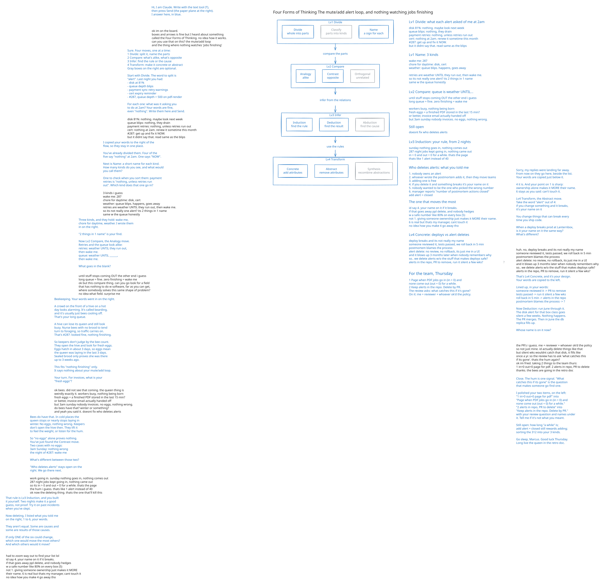
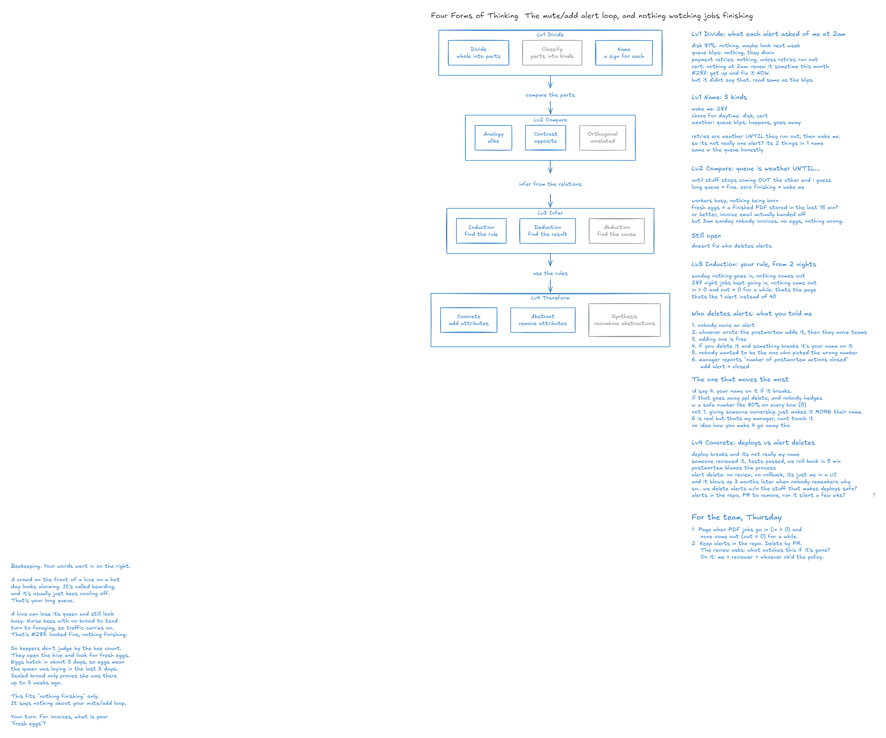

# Sample: "312 alerts last night. The one that mattered was number 287."

This document is a sample consultation with the `consult-on-board` skill.
The client is "Marcus", a fictional backend engineer at "Lanternbox", a fictional company of about 60 people. Claude played Marcus. The consultant is also Claude, running the real skill.
The company, the people and the events are all fictional.
Two separate agents played the two roles. Neither read the other's instructions, and neither was given the far field, the analysis or the answer. A relay passed their words across.

The relay gave the client only this:

- The setting: an engineer on the on-call rotation got 312 alerts last night; the one that mattered was number 287; it was missed and customers noticed first; the team is stuck, because muting misses real problems and adding alerts means nobody reads them. The client opens by telling this story and asking what to do, and invents the alerts, the team and the company's circumstances.
- Three directions: move from the chat to the whiteboard partway through; on the board, ask by name for the Four Forms of Thinking; at Lv2 Compare, ask the consultant to look for a field that has nothing to do with software, as far away as it can get, where someone solves a problem of the same shape. The client had no field in mind. The relay did not name one.

Every line below is as it was said, with one marked exception: three web links in one chat message are removed because they name real companies.
The client talks in the chat first and moves to the whiteboard partway through.
The consultant works through the Four Forms of Thinking: Lv1 Divide, Lv2 Compare, Lv3 Infer and Lv4 Transform. It chose beekeeping as the far field.

- Rounds: chat 3, board 9 (12 in all)
- Question: "what do we even do here?"
- Far field: beekeeping. A hive can lose its queen and still look busy. Keepers do not count bees; they look for fresh eggs.
- Answer, the client's two items for the team: "Page when PDF jobs go in (in > 0) and none come out (out = 0) for a while." and "Keep alerts in the repo. Delete by PR." The review asks: "what catches this if it's gone?"
- Final board: [alert-fatigue.excalidraw](alert-fatigue.excalidraw) (opens in Excalidraw)

## 1. Chat

**Client**

> hey. I'm Marcus, backend eng at Lanternbox (made-up name, small invoicing software company, ~60 people). had the pager last night and I'm pretty fried.
>
> 312 alerts between 6pm and 7am. mostly the usual junk, disk at 81% on some worker, queue depth blips, retry warnings from the payment sync, a cert expiry reminder that fires every hour. around 2am I started ack-ing in bulk just so I could sleep.
>
> number 287 was the one that mattered. invoice PDF generation had quietly stopped, the job queue looked "fine" but nothing was finishing. it looked just like the other 40 queue warnings. first I heard of it was support at 8:40, customers saying their invoices never went out.
>
> and we keep going round in circles. we mute stuff, then we miss a real problem, then postmortem says "add an alert", then nobody reads that one either. 7 of us on the rotation, everyone hates it.
>
> what do we even do here?

**Consultant**

> That's a rough night, Marcus. Bulk-acking at 2am after that many alerts is what most people would do. (I'm assuming the PDF jobs are running again. Tell me if they aren't.)
>
> Here's what I heard, in your words:
>
> - 312 alerts, 6pm to 7am, "mostly the usual junk"
> - Number 287 "looked just like the other 40 queue warnings"
> - The job queue "looked fine", but "nothing was finishing"
> - The loop: mute stuff -> miss a real problem -> postmortem says "add an alert" -> nobody reads that one either
>
> One question before anything else. Say last night had been 20 alerts instead of 312, and you were wide awake. Reading number 287, would you have known invoices had stopped?
>
> Your answer tells us whether this is mostly too much noise, or something else as well.
>
> After that, the Issue-Driven Framework would let you get from that loop to the one question worth answering, so the seven of you stop going round in circles. Just say if you want to see how it works.

**Client**

> yeah PDFs are back, a worker had deadlocked on a font cache lock. restart fixed it. 3 hrs of invoices had to be re-sent by hand.
>
> honestly? no. I went back and read it this morning. it says "queue depth > 500 on pdf-render for 10m". that's it. we see that every month-end and it drains by itself. even wide awake I'd have gone "eh, batch run" and maybe looked at it in 20 min.
>
> the alert only tells you the queue is long. it doesn't say nothing has finished in 40 min. we don't actually have anything that watches that afaik
>
> so I guess it's not only noise?? but the noise is still real, I can't read 312 of anything
>
> the framework thing, I dunno, is it going to tell me anything besides "delete your bad alerts"? bc we've tried that

**Consultant**

> Glad the PDFs are back. Three hours of re-sending by hand on top of that night is grim.
>
> On the framework: no, it wouldn't tell you anything by itself. It only puts shape on what you already know, and you just did that without it. So let's drop it and keep talking.
>
> You've split this into two problems, and they're different:
>
> - Noise: "I can't read 312 of anything"
> - A blind spot: "it doesn't say nothing has finished in 40 min", and "we don't actually have anything that watches that afaik"
>
> That's also why "delete your bad alerts" keeps letting you down. It works on the first problem only. If you'd deleted every junk alert last night, you'd have had a quiet pager and the same 8:40 call from support.
>
> The noise is still real, so I'd like to understand why deleting didn't stick. When you tried it, what actually happened? Which alerts came back, and who put them back?

**Client**

> last spring we did an "alert cleanup week". killed like 90 of them. pager was nice for maybe a month.
>
> then in june a disk actually filled on the db replica. we'd removed the disk alert for that box class. postmortem, action item, Priya put it back but for ALL boxes at 80% bc nobody wanted to be the one who picked the wrong number. that's the 81% worker one from last night.
>
> and that's kinda how every one comes back. nobody owns an alert. whoever wrote the postmortem adds it, then they move teams or whatever. nobody will delete one bc if you delete it and something breaks it's your name on it. adding one is free. deleting one is a career risk (ok slight exaggeration)
>
> also our manager reports "number of postmortem actions closed" so yeah. add alert = closed.
>
> can we draw this somewhere? I keep losing track of what's causing what. is there like a whiteboard or something

**Consultant**

> Yes. The board is open in your browser. It's a shared Excalidraw whiteboard. Write there and press Send. Say 'stop' here to end.
>
> And that story helps a lot. "Adding one is free. Deleting one is a career risk" explains more than the 312 does.
>
> I said we'd drop the frameworks, but one fits what you just asked for. An Interrelationship Digraph lets you stop losing track of what's causing what. It's only boxes and arrows, and it shows which box drives the most others.
>
> Want me to draw one using only what you've told me so far? You'd fix the arrows I get wrong.

## 2. Whiteboard

The client writes in black and presses Send. The consultant answers in blue. Gray boxes in the Four Forms chart are the optional moves.

### 2.1 Lv1 Divide

**Consultant (board)**

> Hi, I am Claude. Write with the text tool (T),
> then press Send (the paper plane at the right).
> I answer here, in blue.

**Client (board)**

> ok im on the board.
> boxes and arrows is fine but I heard about something
> called the Four Forms of Thinking. no idea how it works.
> can you use that on this? the mute/add loop
> and the thing where nothing watches 'jobs finishing'

**Consultant (board)**

> Sure. Four moves, one at a time:
> 1 Divide: split it, name the parts
> 2 Compare: what's alike, what's opposite
> 3 Infer: find the rule or the cause
> 4 Transform: make it concrete or abstract
> Gray boxes on the right are optional.
>
> Start with Divide. The word to split is
> "alert". Last night you had:
> - disk at 81%
> - queue depth blips
> - payment sync retry warnings
> - cert expiry reminder
> - #287, queue depth > 500 on pdf-render
>
> For each one: what was it asking you
> to do at 2am? Your words are fine,
> even "nothing". Write them here and Send.

**Client (board)**

> disk 81%: nothing. maybe look next week
> queue blips: nothing, they drain
> payment retries: nothing, unless retries run out
> cert: nothing at 2am. renew it sometime this month
> #287: get up and fix it NOW.
> but it didnt say that. read same as the blips

**Consultant (board)**

> I copied your words to the right of the
> flow, so they stay in one place.
>
> You've already divided them. Four of the
> five say "nothing" at 2am. One says "NOW".
>
> Next is Name: a short name for each kind.
> How many kinds do you see, and what would
> you call them?
>
> One to check when you sort them: payment
> retries is "nothing, unless retries run
> out". Which kind does that one go in?

**Client (board)**

> 3 kinds i guess
> wake me: 287
> chore for daytime: disk, cert
> weather: queue blips. happens, goes away
> retries are weather UNTIL they run out, then wake me.
> so its not really one alert? its 2 things in 1 name
> same w the queue honestly

### 2.2 Lv2 Compare, and asking for a far field

**Consultant (board)**

> Three kinds, and they hold: wake me,
> chore for daytime, weather. I wrote them
> in on the right.
>
> "2 things in 1 name" is your find.
>
> Now Lv2 Compare, the Analogy move.
> Retries and the queue look alike:
>   retries: weather UNTIL they run out,
>            then wake me.
>   queue:   weather UNTIL ______,
>            then wake me.
>
> What goes in the blank?

**Client (board)**

> until stuff stops coming OUT the other end i guess
> long queue = fine. zero finishing = wake me
> ok but this compare thing. can you go look for a field
> that has nothing to do w software, far as you can get,
> where somebody solves this same shape of problem?
> no idea what field. surprise me

### 2.3 Lv2 Compare: the bees

**Consultant (board)**

> Beekeeping. Your words went in on the right.
>
> A crowd on the front of a hive on a hot
> day looks alarming. It's called bearding,
> and it's usually just bees cooling off.
> That's your long queue.
>
> A hive can lose its queen and still look
> busy. Nurse bees with no brood to tend
> turn to foraging, so traffic carries on.
> That's #287: looked fine, nothing finishing.
>
> So keepers don't judge by the bee count.
> They open the hive and look for fresh eggs.
> Eggs hatch in about 3 days, so eggs mean
> the queen was laying in the last 3 days.
> Sealed brood only proves she was there
> up to 3 weeks ago.
>
> This fits "nothing finishing" only.
> It says nothing about your mute/add loop.
>
> Your turn. For invoices, what is your
> "fresh eggs"?

**Consultant**

> I answered on the board. Here are the sources for the bee facts, if you want to check them:
>
> [Three web links followed here. They are removed because they name real companies.]

**Client (board)**

> ok bees. did not see that coming. the queen thing is
> weirdly exactly it. workers busy, nothing being born
> fresh eggs = a finished PDF stored in the last 15 min?
> or better, invoice email actually handed off
> but 3am sunday nobody invoices. no eggs, nothing wrong.
> do bees have that? winter or something?
> and yeah you said it. doesnt fix who deletes alerts

**Consultant (board)**

> Bees do have that. In cold places the
> queen stops or nearly stops laying in
> winter. No eggs, nothing wrong. Keepers
> don't open the hive then. They lift it
> to feel the weight, or listen for the hum.
>
> So "no eggs" alone proves nothing.
> You've just found the Contrast move.
> Two cases with no eggs:
>   3am Sunday: nothing wrong
>   the night of #287: wake me
>
> What's different between those two?
>
> "Who deletes alerts" stays open on the
> right. We go there next.

**Client (board)**

> work going in. sunday nothing goes in, nothing comes out
> 287 night jobs kept going in, nothing came out
> so its in > 0 and out = 0 for a while. thats the page
> the hum i guess. thats like 1 alert instead of 40
> ok now the deleting thing. thats the one that'll kill this

### 2.4 Lv3 Infer, and who deletes alerts

**Consultant (board)**

> That rule is Lv3 Induction, and you built
> it yourself. Two nights make it a good
> guess, not proof. Try it on past incidents
> when you've slept.
>
> Now deleting. I listed what you told me
> on the right, 1 to 6, your words.
>
> They aren't equal. Some are causes and
> some are results of those causes.
>
> If only ONE of the six could change,
> which one would move the most others?
> And which others would it move?

**Client (board)**

> had to zoom way out to find your list lol
> id say 4. your name on it if it breaks.
> if that goes away ppl delete, and nobody hedges
> w a safe number like 80% on every box (5)
> not 1. giving someone ownership just makes it MORE
> their name. 6 is real but thats my manager, cant touch it
> no idea how you make 4 go away tho

### 2.5 Lv4 Transform

**Consultant (board)**

> Sorry, my replies were landing far away.
> From now on they go here, beside the list.
> Your words are copied just below it.
>
> 4 it is. And your point on 1 is sharp:
> ownership alone makes it MORE their name.
> 6 stays as you said: can't touch it.
>
> Lv4 Transform, the Abstract move.
> Take the word "alert" out of 4:
>   if you change something and it breaks,
>   it's your name on it
>
> You change things that can break every
> time you ship code.
>
> When a deploy breaks prod at Lanternbox,
> is it your name on it the same way?
> What's different?

**Client (board)**

> huh. no, deploy breaks and its not really my name
> someone reviewed it, tests passed, we roll back in 5 min
> postmortem blames the process
> alert delete: no review, no rollback, its just me in a UI
> and it blows up 3 months later when nobody remembers why
> so.. we delete alerts w/o the stuff that makes deploys safe?
> alerts in the repo, PR to remove, run it silent a few wks?

**Consultant (board)**

> That's Lv4 Concrete, and it's your design.
> Your words are copied to the left.
>
> Lined up, in your words:
>   someone reviewed it -> PR to remove
>   tests passed -> run it silent a few wks
>   roll back in 5 min -> alerts in the repo
>   postmortem blames the process -> ?
>
> Now Deduction: run June through it.
> The disk alert for that box class goes
> silent a few weeks. Nothing happens.
> The PR merges. Then in June the db
> replica fills up.
>
> Whose name is on it now?

**Client (board)**

> the PR's i guess. me + reviewer + whoever ok'd the policy
> so not just mine. id actually delete things like that
> but silent wks wouldnt catch that disk, it fills like
> once a yr. so the review has to ask 'what catches this
> if its gone'. thats the hum again?
> ok im fried. taking 2 things to the team thurs:
> 1 in>0 out=0 page for pdf. 2 alerts in repo, PR to delete
> thanks. the bees are going in the retro doc

**Consultant (board)**

> Close. The hum is one signal. "What
> catches this if its gone" is the question
> that makes someone go find one.
>
> I polished your two items, on the left:
> "1 in>0 out=0 page for pdf" into
> "Page when PDF jobs go in (in > 0) and
> none come out (out = 0) for a while."
> "2 alerts in repo, PR to delete" into
> "Keep alerts in the repo. Delete by PR."
> with your review question and names under
> it. Tell me if it's not what you meant.
>
> Still open: how long "a while" is;
> add alert = closed still rewards adding;
> sorting the 312 into your 3 kinds.
>
> Go sleep, Marcus. Good luck Thursday.
> Long live the queen in the retro doc.

## 3. Chat (after the end)

The client went to bed. There was no chat after the board.

## 4. The client's reaction

> honestly better than I expected for something that started with me asking about a thing I'd half heard of. the bees did it. "looks busy, nothing being born" is the first description of last night that actually felt right. and the deploy question got me to the delete thing myself, which is annoying in a good way. still no clue how long "a while" is, and my manager's closed-actions number is still gonna push people to add alerts, so I'm not sold it sticks. but I've got two things to bring thursday and I didn't have that this morning. going to bed.
