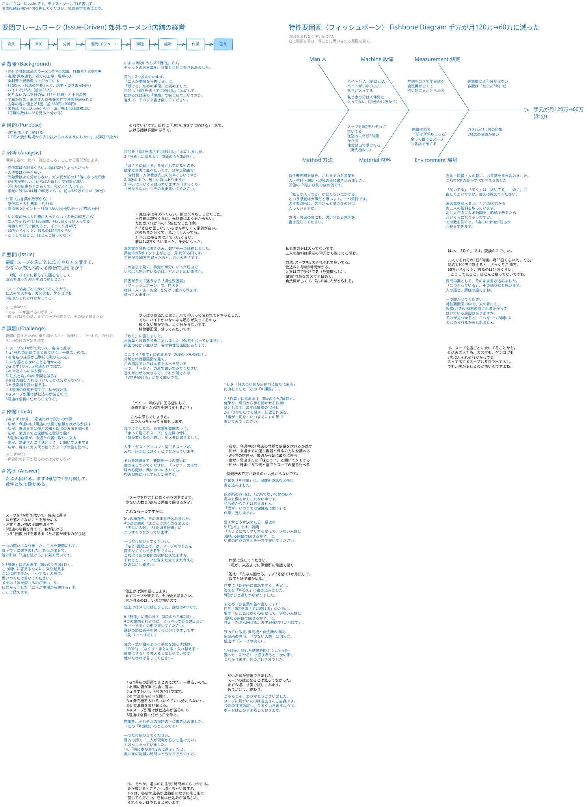

# 見本: 「食材費や光熱費が上がっている。バイトが集まらない。さぁどうする？」

この文書は、`consult-on-board` スキルの相談の見本です。
相談者は郊外でラーメン店を 3 店舗営む架空の店主で、Claude がその役を演じました。コンサルも Claude です。
店も人も数字も、すべて架空です。
相談者はまずチャットで話し、途中からホワイトボードへ移ります。
コンサルは要問フレームワーク（Issue-Driven）の 8 ステップで悩みを整理し、途中で特性要因図（フィッシュボーン）も使います。

- 往復: チャット 3 回、ボード 13 回（合計 16 回）
- 要問: 「スープを店ごとに炊くやり方を変えて、少ない人数と 3 割切る原価で回せるか？」
- 答え: 「たぶん回せる。まず 3 号店で 1 か月試して、数字と味で確かめる。」
- 最後のボード: [ramen-shops-rising-costs-ja.excalidraw](ramen-shops-rising-costs-ja.excalidraw)（Excalidraw で開けます）

## 1. チャット

**相談者**

> 郊外でラーメン店を3店舗やっている店主です。ちょっと相談に乗ってもらえますか。
> 食材費も光熱費もどんどん上がってて、しかもバイトが集まらない。正直、どこから手を付けたらいいか分からなくて。さぁ、どうしたもんかと。
> ざっくり言うと、豚骨醤油の店で、3店合わせて月の売上が1,800万くらい。お客さんは家族連れと近くの工場や現場の人が多いです。

**コンサル**

> ご相談ありがとうございます。コンサルタントの Claude です。原価も人手も同時に苦しい、というのはどこから手を付けるか迷いますよね。
>
> 「どうしたもんか」という広い悩みなので、「要問フレームワーク」を背骨にして、一緒に整理しませんか。
> 背景 → 目的 → 分析 → 要問（いちばん答えるべき問い） → 課題 → 施策 → タスク → 答え、の8段を一段ずつ進めます。いまは「1. 背景」です。
>
> いただいた背景を、お言葉のまま並べます。
> - 郊外で豚骨醤油のラーメン店を3店舗
> - 3店合計の月商 約1,800万円
> - 客層: 家族連れ、近くの工場・現場の人
> - 食材費も光熱費も上がっている
> - バイトが集まらない
>
> 背景をもう少しだけ教えてください。
> 1. 3店の人の体制はどうなっていますか（社員とバイトの人数、足りない時間帯）。
> 2. ここ1年で値上げはしましたか。客数の変化は。
>
> ホワイトボードに描きながら整理することもできます。ボードを使いますか、このままチャットで進めますか。

**相談者**

> ありがとうございます。とりあえずチャットで話させてください。
> 1. 人は、社員が私を入れて5人。各店に店長1人と、私と妻が回ってます。バイトは3店で全部で18人くらい。前は25人いたんですけどね。足りないのは平日の昼（11時〜14時）と、土日の夜。学生が辞めていって、主婦さんも扶養の枠で週に入れる時間が限られてて。
> 2. 値上げは去年の春に1回だけ。並ラーメン850円を900円にしました。客数は、たぶん5%くらい減ったと思います。正確な数字はレジを見ないと分かりません。売上はほぼ横ばいです。

**コンサル**

> ありがとうございます。背景に、お言葉のまま足しました。
>
> 【1. 背景】
> - 郊外で豚骨醤油のラーメン店を3店舗、月商 約1,800万円
> - 客層: 家族連れ、近くの工場・現場の人
> - 食材費も光熱費も上がっている
> - 社員5人（各店の店長3人と、店主・奥さまが回る）
> - バイト 約18人（前は25人）
> - 足りないのは平日の昼（11〜14時）と土日の夜
> - 学生が辞め、主婦さんは扶養の枠で時間が限られる
> - 去年の春に値上げ1回（並 850円→900円）
> - 客数は「たぶん5%くらい」減、売上はほぼ横ばい
>   （正確な数はレジを見ると分かる）
>
> 背景はこれで一区切りにして、「2. 目的」に進みます（8段のうち2段目）。
>
> この相談で、最終的に何を手に入れたいですか。「〜する」の形で、ご自身の言葉で教えてください。
> たとえば利益を守りたいのか、店主さんと奥さまが現場から少し抜けたいのか、3店を続けたいのか、増やしたいのか。いちばん大事なものを一つ、と考えると出しやすいです。

**相談者**

> うーん、いちばん大事なのは「3店を潰さずに続ける」ですね。増やすのは今は考えてないです。
> 正直に言うと、私と妻が毎日どこかの店のヘルプに入ってて、体がきつい。だから続けるためにも、二人が現場から少し抜けられるようにしたい、というのもあります。
> 話が広がってきたので、ホワイトボードで整理したいです。ボードを開いてもらえますか。

**コンサル**

> ホワイトボードを開きました。ブラウザでご覧ください。
> これまでのお話（背景と目的）を書き込み、目的について一つ質問を書きました。ボードに書いて Send（右の紙飛行機）を押してください。答えはボードに書きます。

## 2. ホワイトボード

相談者は黒い字で書き、Send を押します。コンサルは青い字で答え、左の 8 つの欄（背景から答えまで）に要点をまとめます。
分析の途中から、右に特性要因図（フィッシュボーン）が加わります。

### 2.1 目的

**コンサル（ボード）**

> こんにちは、Claude です。テキストツール(T)で書いて、右の紙飛行機(Send)を押してください。私は青字で答えます。
>
> いまは 8段のうち 2「目的」です。
> チャットのお言葉を、背景と目的に書き込みました。
>
> 目的に2つ並んでいます。
> 「二人が現場から抜ける」は「続ける」ための手段、と読めました。
> 目的は「3店を潰さずに続ける」1本にして、抜ける話は後の「課題」で扱う形でよいですか。
> 違えば、そのまま書き直してください。

**相談者（ボード）**

> それでいいです。目的は「3店を潰さずに続ける」1本で。
> 抜ける話は課題のほうで。

### 2.2 分析

**コンサル（ボード）**

> 目的を「3店を潰さずに続ける」1本にしました。
> 3「分析」に進みます（8段のうち3段目）。
>
> 「潰さずに続ける」を脅かしているものを、数字と事実で並べたいです。分かる範囲で:
> 1. 食材費・人件費は売上の何%くらいですか
> 2. 3店の中で、苦しい店はありますか
> 3. 手元に月いくら残っていますか（ざっくり）
>
> 「分からない」もそのまま書いてください。

**相談者（ボード）**

> 1. 原価率は今35%くらい。前は30%ちょっとだった。
>    人件費は28%くらい。光熱費はよく分からない。
>    ただガス代が前の1.5倍になった印象。
> 2. 3号店が苦しい。いちばん新しくて家賃が高い。
>    店長もまだ若くて、私がよく入ってる。
> 3. 手元に残るのは月で60万くらい。
>    前は120万くらいあった。半分になった。

**コンサル（ボード）**

> お言葉を分析に書き込み、数字を一つ計算しました。
> 原価率が5ポイント上がると、月 約90万円です。
> 手元が月60万円減ったのと、近い大きさです。
>
> この並びを見て、手元が半分になった理由でいちばん効いているのは、どれだと思いますか。
>
> 原因が多くて迷うなら「特性要因図」（フィッシュボーン）で、原因を材料・人・店・お金…と分けて並べられます。
> 使ってみますか。

**相談者（ボード）**

> やっぱり原価だと思う。月で90万って言われてドキッとした。
> でも、バイトがいないぶん私らが入ってるのも軽くない気がする。よく分からないです。
> 特性要因図、使ってみたいです。

### 2.3 特性要因図（フィッシュボーン）

**コンサル（ボード）**

> 特性要因図を描き、これまでのお言葉を人・材料・測定・環境の骨に書き込みました。
> 灰色の「例)」は別の店の例です。
>
> 「私らが入ってる」が軽くない気がする、という感覚は大事だと思います。一つ質問です。
> 人件費28%に、店主さんと奥さまの分は入っていますか。
>
> 方法・設備の骨にも、思い当たる原因を書き足してください。

**相談者（ボード）**

> 私と妻の分は入ってないです。
> 二人の給料は手元の60万から取ってる感じ。
>
> 方法: スープを3店それぞれで炙いてる。
>   仕込みに毎朝3時間かかる。
>   注文は口で受けてる（券売機なし）。
> 設備: 寸胴をガスで半日炙く。
>   食洗機が古くて、洗い物に人がとられる。

**コンサル（ボード）**

> 方法・設備・人の骨に、お言葉を書き込みました。
> これで6本の骨がすべて埋まりました。
>
> 「炙いてる」「炙く」は「炊いてる」「炊く」に直してよいですか。違えば教えてください。
>
> お言葉を並べると、手元の60万からお二人の給料を取っています。
> お二人が店に入る時間を、時給で数えたら月いくらになりそうですか。
> その数を引くと、3店にいま何が残るかが見えてきます。

**相談者（ボード）**

> はい、「炊く」です。変換ミスでした。
>
> 二人でそれぞれ1日8時間、月26日くらい入ってる。
> 時給1,100円で数えると、ざっくり月46万。
> 60万から引くと、残るのは14万くらい。
> …こうして見ると、ほとんど残ってないですね。

### 2.4 要問（イシュー）

**コンサル（ボード）**

> 「炊く」に直しました。
> お言葉と計算を分析に足しました（46万も合っています）。
> 原因の細かい並びは、右の特性要因図にあります。
>
> ここで 4「要問」に進みます（8段のうち4段目）。
> 分析と特性要因図を見て、この相談でいちばん答えるべき問いを一つ、「〜か？」の形で書いてみてください。
> 答えが出せる大きさで、それが解ければ「3店を続ける」に効く問いです。

**相談者（ボード）**

> 「バイトに頼らずに回る店にして、
> 原価で減った90万を取り戻せるか？」
>
> こんな感じでしょうか。
> 二つ入っちゃってる気もします。

**コンサル（ボード）**

> 要問の案として、そのまま書き込みました。
> 「二つ入っている」、その通りだと思います。人の話と、原価の話ですね。
>
> 一つ聞かせてください。
> 特性要因図の中で、人の骨にも、設備(ガス)や材料の骨にもまたがって効いている原因はありますか。
> それが見つかると、二つを一つの問いにまとめられるかもしれません。

**相談者（ボード）**

> あ、スープを店ごとに炊いてることかも。
> 仕込みの人手も、ガス代も、ゲンコツも3店ぶんそれぞれかかってる。
> 余って捨てるスープも各店で出てるし。
> でも、味が変わるのが怖いんですよね。

**コンサル（ボード）**

> 見つけましたね。お言葉を要問の下に、「余って捨てるスープ」を材料の骨に、「味が変わるのが怖い」をメモに書きました。
> 人手・ガス・ゲンコツ・捨てるスープが、みな「店ごとに炊く」につながっています。
>
> それを踏まえて、要問を一つの問いに書き直してみてください。「〜か？」の形で。
> 味の心配は、問いの中に入れても、後の課題に回しても大丈夫です。

**相談者（ボード）**

> 「スープを店ごとに炊くやり方を変えて、
> 少ない人数と3割切る原価で回せるか？」
>
> これなら一つですかね。

### 2.5 課題

**コンサル（ボード）**

> 一つの問いになりました。これを要問にして、青字で上に書きました。
> 答えが出せて、解ければ「3店を続ける」に効く問いです。
>
> 5「課題」に進みます（8段のうち5段目）。
> この問いに答えるために、乗り越えることは何ですか。「〜する」の形で、思いつくだけ書いてください。
> メモの「味が変わるのが怖い」や、目的から回した「二人が現場から抜ける」もここで扱えます。

**相談者（ボード）**

> - スープを1か所で炊いて、各店に運ぶ
> - 味を落とさないことを確かめる
> - 注文と洗い物の手間を減らす
> - 3号店の店長を育てて、私が抜ける
> - もう1回値上げを考える（ただ客が減るのが心配）

**コンサル（ボード）**

> 5つの課題を、そのまま書き込みました。
> 4つは要問の「店ごとに炊くのを変える」「少ない人数」「3割切る原価」にまっすぐつながっています。
>
> 一つだけ聞かせてください。
> 「もう1回値上げ」は、スープのやり方を変えなくてもできる手ですね。
> これは今回の要問の課題に入れますか。
> それとも、スープを変えた後でまた考える別の話にしますか。

**相談者（ボード）**

> 値上げは別の話にします。
> まずスープを変えて、その後で考えたい。
> 客が減るのは、いまは怖いので。

### 2.6 施策

**コンサル（ボード）**

> 値上げはメモに移しました。課題は4つです。
>
> 6「施策」に進みます（8段のうち6段目）。
> 4つの課題それぞれに、どうやって乗り越えるかを「〜する」の形で書いてください。
> 課題の頭に番号を付けると分けやすいです（例: 1-a 〜する）。
>
> 注文・洗い物のように手間を減らす話は、「ECRS」（なくす・まとめる・入れ替える・簡単にする）で考えると出しやすいです。
> 使いたければ言ってください。

**相談者（ボード）**

> 1-a 1号店の厨房でまとめて炊く。一番広いので。
> 1-b 朝に妻が車で2店に運ぶ。
> 2-a まず1か月、3号店だけで試す。
> 2-b 常連さんに味を聞く。
> 3-a 券売機を入れる（いくらかは分からない）。
> 3-b 食洗機を買い替える。
> 4-a スープが届けば仕込みが減るので、
>     3号店は店長に任せる日を作る。

**コンサル（ボード）**

> 施策を、それぞれの課題の下に書き込みました。（左の「# 課題」のところです）
>
> 一つだけ聞かせてください。
> 目的の話で「二人が現場から少し抜けたい」とおっしゃっていました。
> 1-b「朝に妻が車で2店に運ぶ」だと、奥さまの毎朝の時間はどうなりそうですか。

**相談者（ボード）**

> あ、そうか。運ぶのに往復1時間半くらいかかる。
> 妻が抜けるどころか、増えちゃいますね。
> 1-b は、各店の店長が出勤前に取りに来る形に直してください。
> 店長は仕込みが減るぶん、それくらいはやれると思います。

### 2.7 作業

**コンサル（ボード）**

> 1-b を「各店の店長が出勤前に取りに来る」に直しました（左の「# 課題」）。
>
> 7「作業」に進みます（8段のうち7段目）。
> 施策を、明日から手を動かせる作業に落とします。
> まずは最初の1か月、2-a「3号店だけで試す」に要る作業を、「誰が・何を・いつまでに」の形で書いてみてください。

**相談者（ボード）**

> - 私が、今週中に1号店の寸胴で倍量を炊けるか試す
> - 私が、来週までに運ぶ容器と保冷の方法を調べる
> - 3号店の店長が、来週から朝に取りに来る
> - 妻が、常連さんに「味どう？」と聞いてメモする
> - 私が、月末にガス代と捨てたスープの量を比べる
>
> 保健所の許可が要るのかは分からないです。

### 2.8 答え

**コンサル（ボード）**

> 作業を「# 作業」に、保健所の話をメモに書き込みました。
>
> 保健所の許可は、1か所で炊いて他の店へ運ぶと要るかもしれない点です。
> 私も確かなことは言えません。
> 「誰が・いつまでに保健所に聞く」を作業に足しますか。
>
> 足すかどうか決めたら、最後の 8「答え」です。
> 要問「店ごとに炊くやり方を変えて、少ない人数と3割切る原価で回せるか？」に、いまの時点の答えを一言で書いてください。

**相談者（ボード）**

> 作業に足してください。
> - 私が、来週までに保健所に電話で聞く
>
> 答え: 「たぶん回せる。まず3号店で1か月試して、数字と味で確かめる。」

### 2.9 おわり

**コンサル（ボード）**

> 作業に「保健所に電話で聞く」を足し、答えを「# 答え」に書き込みました。
> 8段がひと通りつながりました。
>
> まとめ（お言葉の並べ直しです）:
> 目的「3店を潰さずに続ける」のために、
> 要問「店ごとに炊くのを変えて、少ない人数と3割切る原価で回せるか？」に、
> 答え「たぶん回せる。まず3号店で1か月試す」。
>
> 残っている点: 券売機と食洗機の値段、保健所の許可、「少ない人数」は何人か、値上げ（スープの後で）。
>
> 1か月後、試した結果をKPT（よかった・困った・次やる）で振り返ると、次の手につながります。おつかれさまでした。

**相談者（ボード）**

> だいぶ頭が整理できました。
> スープの話になるとは思ってなかった。
> まず今週、寸胴で試してみます。
> ありがとう、終わり。

**コンサル（ボード）**

> こちらこそ、ありがとうございました。
> スープに気づいたのは店主さんご自身です。
> 今週の寸胴の試し、うまくいきますように。
> ボードはこのまま残しておきます。

## 3. 相談者の感想

- 分かりやすかった所: コンサルは相談者の数字をすぐ計算して返した（原価率 5 ポイント = 月 約 90 万円、夫婦の労働 = 月 約 46 万円）。特性要因図で、「スープを店ごとに炊く」が人・設備・材料の骨にまたがると相談者自身が気づいた。
- 助かった所: コンサルは施策 1-b（奥さまが運ぶ）を目的「二人が現場から抜ける」と照らし合わせ、相談者が自分で直せる形で問い返した。
- 迷った所: 要問を「一つの『〜か？』」にまとめるのに、2 回書き直した。ボードは返事のたびに画面が動き、古い書き込みも残るので、どこに何があるか探しにくかった。
