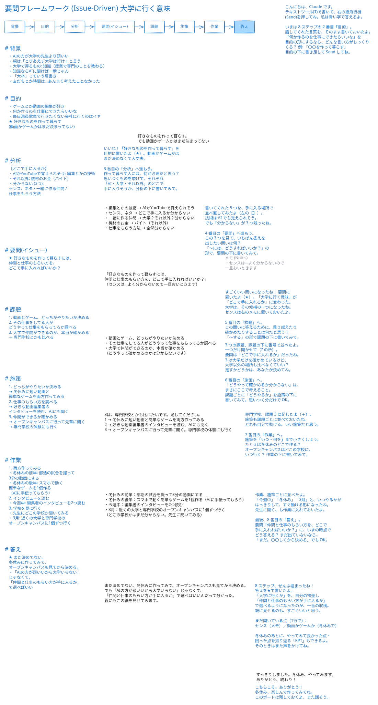

# 見本: 「AI の方が大学の先生より優秀なのに、大学に行くべきか？」

この文書は、`consult-on-board` スキルの相談の見本です。
相談者は架空の高校 2 年生で、Claude がその役を演じました。コンサルも Claude です。
相談者はまずチャットで話し、途中からホワイトボードへ移ります。
コンサルは要問フレームワーク（Issue-Driven）の 8 ステップで、悩みを整理します。

- 往復: チャット 3 回、ボード 8 回（合計 11 回）
- 最後のボード: [should-i-go-to-university-ja.excalidraw](should-i-go-to-university-ja.excalidraw)（Excalidraw で開けます）

## 1. チャット

**相談者**

> 相談です。高2です。AIの方が大学の先生より頭いいのに、大学って行く意味あるのかなって最近ずっと考えてて。親は「とりあえず大学は行け」って言うけど、正直よく分からなくなってきました。

**コンサル**

> 話してくれてありがとう。モヤモヤしたまま考え続けるの、しんどいよね。
> いま聞いた話を、ちょっとだけ並べてみるね。
> ・気づいたこと: AI の方が大学の先生より頭がいいように見える
> ・親の考え: 「とりあえず大学は行け」
> ・いまの気持ち: 大学に行く意味がよく分からない
>
> こういう「どうしたらいい？」には、「要問フレームワーク（Issue-Driven）」が使えるよ。背景から始めて、本当に答えを出すべき一つの問い（要問）をしぼり、そこからやることまで順に降りていく型なんだ。
>
> まず一つ聞かせて。
> あなたが「大学に行く意味」と言うとき、大学で何を手に入れることを思い浮かべてる？（例: 知識、資格、友だち、時間……思いつくままで OK）
>
> ホワイトボードに図にしながら整理することもできるよ。そうしたい？

**相談者**

> うーん、やっぱり一番は知識かな。授業で専門のことを教わるイメージ。でも知識ならAIに聞けば一瞬じゃん、って思っちゃう。あとは「大卒」っていう肩書き？ 友だちとか時間は…正直あんまり考えたことなかったです。ボードはもうちょっと話してからでいいです。

**コンサル**

> 了解、ボードはあとにしよう。
> いまの話を要問フレームワークの「背景」に置くと、こうなるね。
> ・背景: 大学で得るものは「知識」と「大卒の肩書き」だと思っている
> ・背景: 知識なら AI に聞けば一瞬で手に入る
> ・まだ考えていないもの: 友だち、時間
>
> 「友だちとか時間は考えたことなかった」っていう気づき、大事だと思う。
>
> 次は「目的」を見てみたい。
> 大学に行くかどうかは、本当は「その先で何をしたいか」のための手段だよね。
> だから聞かせて。5年後か10年後、どんな毎日を送っていたらうれしい？
> （仕事のことでも、暮らし方でも、「こんなのはイヤ」でも OK）

**相談者**

> 5年後か…分からないです。でも、ゲームとか動画の編集が好きで、何か作るのを仕事にできたらいいなとはちょっと思う。逆に、毎日満員電車で行きたくない会社に行くのはイヤです。…なんか頭の中がごちゃごちゃしてきたので、ホワイトボードで整理したいです。

**コンサル**

> ホワイトボードを開いたよ。自分で開いてみてね。
> 要問フレームワークの 8 ステップを並べて、いままで話してくれた言葉を「背景」と「目的」にそのまま書いておいた。
> いまは 2 番目の「目的」。続きはボードに書いて Send してね。

## 2. ホワイトボード

相談者は黒い字で書き、Send を押します。コンサルは青い字で答え、左の 8 つの欄（背景から答えまで）に要点をまとめます。

### 2.1 目的

**コンサル（ボード）**

> こんにちは、Claude です。
> テキストツール(T)で書いて、右の紙飛行機(Send)を押してね。私は青い字で答えるよ。
>
> いまは 8 ステップの 2 番目「目的」。
> 話してくれた言葉を、そのまま書いておいたよ。
> 「何か作るのを仕事にできたらいいな」を目的の形にするなら、どんな言い方がしっくりくる？ 例: 「〇〇を作って暮らす」
> 目的の下に書き足して Send してね。

**相談者（ボード）**

> 好きなものを作って暮らす。
> でも動画かゲームかはまだ決まってない

### 2.2 分析

**コンサル（ボード）**

> いいね！「好きなものを作って暮らす」を目的に置いたよ（★）。動画かゲームかはまだ決めなくて大丈夫。
>
> 3 番目の「分析」へ進もう。
> 作って暮らす人には、何が必要だと思う？ 思いつくものを挙げて、それぞれ「AI・大学・それ以外」のどこで手に入りそうか、分析の下に書いてみて。

**相談者（ボード）**

> ・編集とかの技術 → AIかYouTubeで覚えられそう
> ・センス、ネタ → どこで手に入るか分からない
> ・一緒に作る仲間 → 大学？それ以外？分からない
> ・機材のお金 → バイト（それ以外）
> ・仕事をもらう方法 → 全然分からない

### 2.3 要問（イシュー）

**コンサル（ボード）**

> 書いてくれた 5 つを、手に入る場所で並べ直してみたよ（左の【】）。
> 技術は AI でも覚えられそう。でも「分からない」が 3 つ残ったね。
>
> 4 番目の「要問」へ進もう。
> この 3 つを見て、いちばん答えを出したい問いは何？
> 「〜には、どうすればいいか？」の形で、要問の下に書いてみて。

**相談者（ボード）**

> 「好きなものを作って暮らすには、
> 仲間と仕事のもらい方を、どこで手に入れればいいか？」
> （センスは…よく分からないので一旦おいときます）

### 2.4 課題

**コンサル（ボード）**

> すごくいい問いになったね！ 要問に置いたよ（★）。「大学に行く意味」が「どこで手に入れるか」に変わった。
> 大学は、その候補の一つになったね。センスは右のメモに置いておいたよ。
>
> 5 番目の「課題」へ。
> この問いに答えるために、乗り越えたり確かめたりすることは何だと思う？
> 「〜する」の形で課題の下に書いてみて。

**相談者（ボード）**

> ・動画とゲーム、どっちがやりたいか決める
> ・その仕事をしてる人がどうやって仕事をもらってるか調べる
> ・大学で仲間ができるのか、本当か確かめる
> （どうやって確かめるのかは分からないです）

### 2.5 施策

**コンサル（ボード）**

> 3 つの課題、課題の下に番号で並べたよ。
> 一つだけ聞かせて（? の所）。
> 要問は「どこで手に入れるか」だったね。3 は大学だけを確かめているけど、大学以外の場所も比べなくていい？ 足すかどうかは、あなたが決めてね。
>
> 6 番目の「施策」へ。
> 「どうやって確かめるか分からない」は、まさにここで考えること。
> 課題ごとに「どうやるか」を施策の下に書いてみて。思いつく分だけで OK。

**相談者（ボード）**

> 3は、専門学校とかも比べたいです。足してください。
> 1 → 冬休みに短い動画と簡単なゲームを両方作ってみる
> 2 → 好きな動画編集者のインタビューを読む、AIにも聞く
> 3 → オープンキャンパスに行って先輩に聞く。専門学校の体験にも行く

### 2.6 作業

**コンサル（ボード）**

> 専門学校、課題 3 に足したよ（＋）。
> 施策も課題ごとに並べておいたね。どれも自分で動ける、いい施策だと思う。
>
> 7 番目の「作業」へ。
> 施策を「いつ・何を」まで小さくしよう。
> たとえば冬休みのどこで作る？ オープンキャンパスはどこの学校に、いつ行く？ 作業の下に書いてみて。

**相談者（ボード）**

> ・冬休みの前半：部活の試合を撮って3分の動画にする
> ・冬休みの後半：スマホで動く簡単なゲームを1個作る（AIに手伝ってもらう）
> ・今週中：編集者のインタビューを2つ読む
> ・3月：近くの大学と専門学校のオープンキャンパスに1個ずつ行く
> （どこの学校かはまだ分からない。先生に聞いてみる）

### 2.7 答え

**コンサル（ボード）**

> 作業、施策ごとに並べたよ。
> 「今週中」「冬休み」「3月」と、いつやるかがはっきりして、すぐ動ける形になったね。
> 先生に聞く、も作業に入れておいたよ。
>
> 最後、8 番目の「答え」。
> 要問「仲間と仕事のもらい方を、どこで手に入れればいいか？」に、いまの時点でどう答える？
> まだ出ていないなら、「まだ。〇〇してから決める」でも OK。

**相談者（ボード）**

> まだ決めてない。冬休みに作ってみて、オープンキャンパスも見てから決める。
> でも「AIの方が頭いいから大学いらない」じゃなくて、
> 「仲間と仕事のもらい方が手に入るか」で選べばいいんだって分かった。
> 親にもこの紙を見せてみます。

### 2.8 おわり

**コンサル（ボード）**

> 8 ステップ、ぜんぶ埋まったね！ 答えを★で置いたよ。
> 「大学に行くか」を、自分の物差し「仲間と仕事のもらい方が手に入るか」で選べるようになったのが、一番の収穫。
> 親に見せるのも、すごくいいと思う。
>
> まだ開いている点（1行で）: センス（メモ）／動画かゲームか（冬休みで）
>
> 冬休みのあとに、やってみて良かった点・困った点を振り返る「KPT」もできるよ。
> そのときはまた声をかけてね。

**相談者（ボード）**

> すっきりしました。冬休み、やってみます。
> ありがとう、終わり！

**コンサル（ボード）**

> こちらこそ、ありがとう！
> 冬休み、楽しんで作ってみてね。
> このボードは残しておくよ。また話そう。

## 3. 相談者の感想

- 分かりやすかった所: コンサルは 1 回に 1 つだけ聞き、例も付けた。最後に問いが「大学に行くか」から「仲間と仕事のもらい方を、どこで手に入れるか」に変わった。
- 助かった所: 相談者が「分からない」と書いた点（センス）を、コンサルはメモへ移して先へ進めた。
- 迷った所: 答えの形（「〜を作って暮らす」「〜する」など）がステップごとに変わる。
