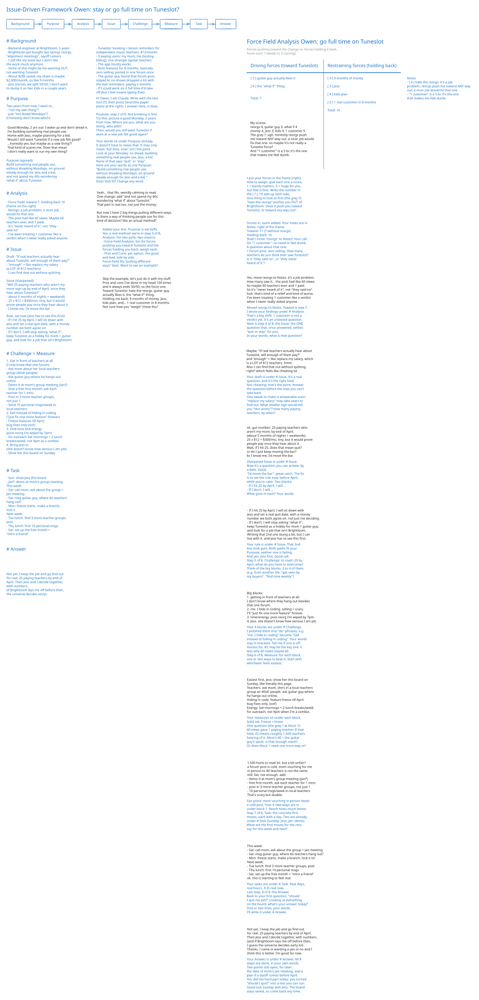
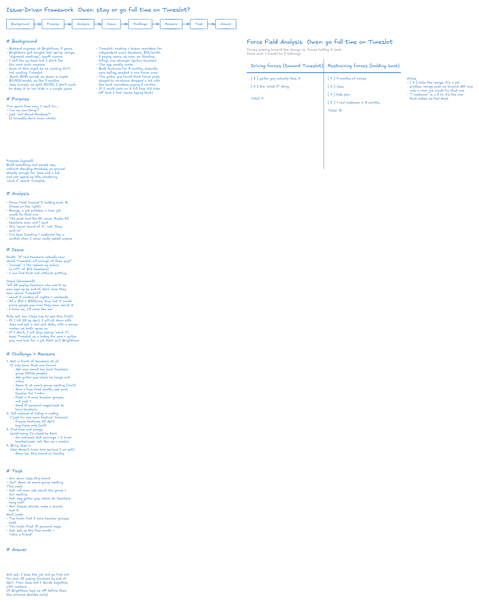

# Sample: "Should I quit my job for my side project? It has 3 paying users. Two are my mom and me."

This document is a sample consultation with the `consult-on-board` skill.
The client is "Owen", a fictional backend engineer at "Brightloom", a fictional logistics software company. On the side he builds "Tuneslot", a fictional booking and reminder app for music teachers. Claude played Owen. The consultant is also Claude, running the real skill.
The company, the people, the product and the events are all fictional.
Two separate agents played the two roles. Neither read the other's instructions, and neither was given a framework name, the Issue, the analysis or the answer. A relay passed their words across.

The relay gave the client only this:

- The setting: an engineer at a software company builds a small SaaS product on the side; it has 3 paying users, and 2 of them are his mother and himself; he is torn about quitting his job to work on it full time. The client opens by asking whether he should quit, and invents the product, the numbers, his savings, his family and his company's situation.
- Two directions: move from the chat to the whiteboard partway through; on the board, without naming any method, ask something like "Is there a way of thinking people use for this kind of decision?"

Every line below is as it was said.
The client talks in the chat first and moves to the whiteboard partway through.
The consultant picked the frameworks itself from the skill's list. It used the Issue-Driven Framework as the spine. When the client asked for a method at the Analysis step, it offered a Force Field Analysis or a pros and cons list, and the client chose the Force Field Analysis.

- Rounds: chat 3, board 13 (16 in all)
- Question: "should I quit my job?"
- Frameworks the consultant chose: Issue-Driven Framework (spine), Force Field Analysis (at Analysis)
- Issue: "Will 25 paying teachers who aren't my mom sign up by end of April, once they hear about Tuneslot?"
- Answer: "Not yet. I keep the job and go find out for real: 25 paying teachers by end of April. Then Jess and I decide together, with numbers."
- Final board: [side-project-quit-job.excalidraw](side-project-quit-job.excalidraw) (opens in Excalidraw)

## 1. Chat

**Client**

> Hi. Quick thing up front, all the names here are made up (company, product, me). I'm Owen, backend engineer at a logistics software company I'll call Brightloom. Been there 5 years.
>
> So, straight question: should I quit my job?
>
> On the side I built a little booking + lesson reminder app for independent music teachers, I call it Tuneslot. $12/month. It has 3 paying users. One is my mom (she teaches piano), one is me (I pay for it to test billing, I know, I know), and one is an actual stranger, a guitar teacher two states away.
>
> I keep thinking if I could just work on it full time it'd take off. But I also kind of feel insane typing that out.

**Consultant**

> Hi Owen. You're not insane for typing it out. A lot of people have that same thought about a side project, and it deserves a proper look.
>
> You asked me straight, so here's a straight answer: I won't tell you yes or no yet. It's your life and your call. What I can do is help you see the decision clearly enough that the answer gets obvious to you.
>
> Here's what I'm hearing so far:
> - 5 years as a backend engineer at Brightloom
> - Tuneslot: a booking and reminder app for independent music teachers, $12/month
> - 3 paying users: your mom, you, and one real stranger (so about $12/month from outside)
> - A pull: "if I worked on it full time, it would take off"
> - A doubt: "I feel kind of insane saying that"
>
> A few questions to get the real picture:
> 1. What's pulling you away from Brightloom? Is it mostly Tuneslot, or is something about the job itself wearing on you?
> 2. How long could you live with no salary? (Rough months of savings, other income, anyone who depends on you.)
> 3. What's held Tuneslot back so far: time to build, or finding teachers who'll pay?
> 4. Do you know how the guitar teacher found you, and why they stayed?
>
> Take whichever ones you like, in any order.
>
> Once we have that, I can offer a simple step-by-step way to sort it out (the Issue-Driven Framework). It starts from your situation, finds the one question that really matters, and works down to concrete next steps. We can do it here in the chat, or on a whiteboard if you'd rather see it laid out.

**Client**

> ok, honest answers:
>
> 1. both tbh. Brightloom got bought by a bigger company last spring and since then it's reorgs and "alignment meetings". there are layoff rumors. I still like my team but I don't like the work much anymore. so some of this might be me wanting OUT, not wanting Tuneslot. I hadn't really admitted that.
>
> 2. about $28k saved. rent is $1,650, my share of everything is maybe $2,900/month, so like 9 months? my partner Jess is a nurse and earns ok but we split things 50/50 and I don't want to dump it on her. no kids. we've talked about kids in a couple years though.
>
> 3. finding teachers. the app mostly works. I built features for 8 months and did basically zero selling. I posted in one teacher forum once.
>
> 4. the guitar guy found that one forum post. he said he stayed bc no-shows dropped a lot with the text reminders. he's been paying 5 months.
>
> also you said "Issue-Driven Framework" like I'm supposed to know what that is lol. what is it, simply?

**Consultant**

> Fair, that was jargon. Thanks for the honest answers, especially the first one. "Some of this might be me wanting OUT, not wanting Tuneslot" is a big thing to notice.
>
> The Issue-Driven Framework, simply: big worries feel heavy because ten questions are tangled together. This method untangles them and picks the ONE question that, once answered, settles the rest. Then it works down from that question to things you can actually do.
>
> It goes in steps, top to bottom:
> 1. Background: what's going on (the facts)
> 2. Purpose: what you really want out of this
> 3. Analysis: what the facts tell you
> 4. Issue: the one question that matters most
> 5. Challenges: what stands in the way of answering it
> 6. Measures: ways to tackle each challenge
> 7. Tasks: concrete next steps, with dates
> 8. Answer: your decision
>
> A tiny example from a different life: someone asks "should I move to another city?" The real Issue turns out to be "Can I find work there I'd enjoy?" Once that's answered, the move mostly decides itself.
>
> You've already given me most of the Background:
> - Brightloom was bought; reorgs, alignment meetings, layoff rumors
> - You like your team but not the work anymore
> - About $28k saved, about $2,900/month share, so about 9 months of runway
> - Jess, 50/50 split, you don't want to put it on her; kids maybe in a couple of years
> - Tuneslot mostly works; 8 months of building, almost no selling, one forum post
> - The one stranger came from that post, has paid 5 months, stays because text reminders cut no-shows
>
> Want to walk through the steps? We can do it here in the chat, or on a whiteboard where you can see it all laid out. Next step would be Purpose: what do you actually want, say, two years from now?

**Client**

> ok that makes sense actually. the city example helped.
>
> yeah lets do the whiteboard, I think I need to see it all in one place. my head is kind of spinning.
>
> and two years from now... I honestly don't know if the answer is "run my own thing" or just "not dread mondays". can we start there on the board?

**Consultant**

> The board is open in your browser. Write there and press Send. Say 'stop' here to end.
>
> I've put the eight steps across the top, with Purpose (step 2 of 8) highlighted. Under it, I wrote in everything you've told me as Background, in your own words, so you can see it all in one place. Your "run my own thing" vs. "not dread Mondays" is already under Purpose, with a question from me next to it to help you sort out which one it is.

## 2. Whiteboard

The client writes in black and presses Send. The consultant answers in blue.

### 2.1 Purpose, and asking for a method

**Consultant (board)**

> Hi Owen, I am Claude. Write with the text
> tool (T), then press Send (the paper
> plane at the right). I answer here, in blue.
>
> Purpose, step 2 of 8. Not knowing is fine.
> Try this: picture a good Monday, 2 years
> from now. Where are you, what are you
> doing, who with?
> Then: would you still want Tuneslot if
> work at a new job felt good again?

**Client (board)**

> Good Monday, 2 yrs out: I wake up and don't dread it.
> I'm building something real people use.
> Home with Jess, maybe planning for a kid.
> Would I still want Tuneslot if a new job felt good?
> ...honestly yes, but maybe as a side thing??
> That kind of scares me. Does that mean
> I don't really want to run my own thing?

**Consultant (board)**

> Your words sit under Purpose already.
> It doesn't have to mean that. It may only
> mean "full time, now" isn't the point.
> Look at your Monday: no dread, building
> something real people use, Jess, a kid.
> None of that says "quit" or "stay".
> Here are your words as one Purpose:
> "Build something real people use,
> without dreading Mondays, on ground
> steady enough for Jess and a kid."
> Does that fit? Change any word.

**Client (board)**

> Yeah... that fits. weirdly calming to read.
> One change: add "and not spend my 40s
> wondering 'what if' about Tuneslot."
> That part is real too, not just the money.
>
> But now I have 2 big things pulling different ways.
> Is there a way of thinking people use for this
> kind of decision? like an actual method?

**Consultant (board)**

> Added your line. Purpose is set (left).
> Yes, a real method: we're in step 3 of 8,
> Analysis. For two pulls, two classics:
> - Force-Field Analysis: list the forces
>   pushing you toward Tuneslot and the
>   forces holding you back, weigh each.
> - Pros and Cons: per option, the good
>   and bad, side by side.
> Force-Field fits "pulling different
> ways" best. Want to see an example?

### 2.2 Analysis: the Force Field

**Client (board)**

> Skip the example, let's just do it with my stuff.
> Pros and cons I've done in my head 100 times
> and it always ends 50/50, so the force one.
> Toward Tuneslot: hate the reorgs, guitar guy
> actually likes it, the "what if" thing.
> Holding me back: 9 months of money, Jess,
> kids plan, and... 1 real customer in 8 months.
> Not sure how you "weigh" these tho?

**Consultant (board)**

> I put your forces in the frame (right).
> How to weigh: give each one a score,
> 1 = barely matters, 5 = huge for you.
> Gut feel is fine. Write the number in
> the [ ? ]. I'll add up each side.
> One thing to look at first (the gray ?):
> "hate the reorgs" pushes you OUT of
> Brightloom. Does it push you toward
> Tuneslot, or toward any way out?

**Client (board)**

> My scores:
> reorgs 4, guitar guy 3, what if 4
> money 4, Jess 3, kids 4, 1 customer 5
> The gray ?: ugh. honestly reorgs push
> me toward ANY way out. a nicer job would
> fix that one. so maybe it's not really a
> Tuneslot force?
> And "1 customer" is a 5 bc it's the one
> that makes me feel dumb.

**Consultant (board)**

> Scores in, sums added. Your notes are in
> Notes, right of the frame.
> Toward: 11 (7 without reorgs)
> Holding back: 16
> Shall I move "reorgs" to Notes? Your call.
> On "1 customer": no need to feel dumb.
> A question about that one:
> 1 forum post, zero selling. How many
> teachers do you think ever saw Tuneslot?
> Is it "they said no", or "they never
> heard of it"?

**Client (board)**

> Yes, move reorgs to Notes. it's a job problem.
> How many saw it... the post had like 60 views.
> So maybe 60 teachers ever. and 1 paid.
> So it's "never heard of it", not "they said no".
> huh. that's kind of a relief and kind of worse.
> I've been treating 1 customer like a verdict
> when I never really asked anyone.

**Consultant (board)**

> Moved reorgs to Notes. Toward is now 7.
> I wrote your findings under # Analysis.
> That's a big shift: 1 customer is not a
> verdict yet. It's an untested question.
> Next is step 4 of 8, the Issue: the ONE
> question that, once answered, settles
> "quit or stay" for you.
> In your words, what is that question?

### 2.3 Issue

**Client (board)**

> Maybe: "If real teachers actually hear about
> Tuneslot, will enough of them pay?"
> and "enough" = like replace my salary, which
> is a LOT of $12 teachers. hmm.
> Also I can find that out without quitting,
> right? which feels like cheating lol

**Consultant (board)**

> Your draft is under # Issue. It's a real
> question, and it's the right kind.
> Not cheating: that's the point. Answer
> the question before the step you can't
> take back.
> One tweak to make it answerable soon:
> "replace my salary" may take years to
> find out. What smaller sign would tell
> you "this works"? How many paying
> teachers, by when?

**Client (board)**

> ok. gut number: 25 paying teachers who
> aren't my mom, by end of April.
> (about 5 months of nights + weekends)
> 25 x $12 = $300/mo, tiny, but it would prove
> people pay once they hear about it.
> Wait, if I hit 25, does that mean quit?
> or do I just keep moving the bar?
> bc I know me, I'd move the bar.

**Consultant (board)**

> Sharpened Issue is under # Issue.
> Now it's a question you can answer by
> a date. Good.
> "I'd move the bar": great catch. The fix
> is to set the rule now, before April,
> while you're calm. Two blanks:
> - If I hit 25 by April, I will ...
> - If I don't, I will ...
> What goes in each? Your words.

**Client (board)**

> - If I hit 25 by April, I will sit down with
>   Jess and set a real quit date, with a money
>   number we both agree on. not just me deciding.
> - If I don't, I will stop asking "what if",
>   keep Tuneslot as a hobby for mom + guitar guy,
>   and look for a job that isn't Brightloom.
> Writing that 2nd one stung a bit. but I can
> live with it. and Jess has to see this first.

**Consultant (board)**

> Your rule is under # Issue. That 2nd
> line took guts. Both paths fit your
> Purpose; neither one is failing.
> And yes: Jess first. Good call.
> Step 5 of 8, Challenge: to reach 25 by
> April, what do you have to overcome?
> Think of the big blocks, 2 to 4 of them.
> (e.g. from another life: "get seen by
> my buyers", "find time weekly")

### 2.4 Challenge

**Client (board)**

> Big blocks:
> 1. getting in front of teachers at all.
>    I don't know where they hang out besides
>    that one forum.
> 2. me. I hide in coding. selling = scary.
>    I'll "just fix one more feature" forever.
> 3. time/energy. post-reorg I'm wiped by 7pm.
> 4. Jess. she doesn't know how serious I am yet.

**Consultant (board)**

> Your 4 blocks are under # Challenge.
> I polished them into "do" phrases, e.g.
> "me. I hide in coding" became "Sell
> instead of hiding in coding". Your words
> stay in brackets. Tell me if one is off.
> Honest list. #2 may be the key one: it
> was why 60 views stayed 60.
> Step 6 of 8, Measure: for each block,
> one or two ways to beat it. Start with
> whichever feels easiest.

### 2.5 Measure

**Client (board)**

> Easiest first, Jess: show her this board on
> Sunday. like literally this page.
> Teachers: ask mom, she's in a local teachers
> group w/ 40ish people. ask guitar guy where
> he hangs out online.
> Hiding in code: feature freeze till April.
> bug fixes only. (oof)
> Energy: Sat mornings + 2 lunch breaks/week
> for outreach, not 9pm when I'm a zombie.

**Consultant (board)**

> Your measures sit under each block.
> Solid set. Freeze = brave.
> One question (the gray ? at block 1):
> 60 views gave 1 paying teacher. If that
> held, 25 means roughly 1,500 teachers
> hearing of it. Mom's 40 + the guitar
> guy's spots: is that enough reach?
> Or does block 1 need one more way in?

**Client (board)**

> 1,500 hurts to read lol. but a bit unfair?
> a forum post is cold. mom vouching for me
> in person to 40 teachers is not the same.
> still, fair, not enough. add:
> - demo it at mom's group meeting (Jan?)
> - free first month, ask each teacher for 1 intro
> - post in 3 more teacher groups, not just 1
> - 10 personal msgs/week to local teachers
> That's scary but doable.

**Consultant (board)**

> Fair point: mom vouching in person beats
> a cold post. Your 4 new ways are in
> under block 1. Reach looks much better.
> Step 7 of 8, Task: the concrete first
> moves, each with a day. Two are already
> under # Task (Sunday: Jess; Jan: demo).
> What are the first moves for the rest,
> say for this week and next?

### 2.6 Task

**Client (board)**

> This week:
> - Sat: call mom, ask about the group + Jan meeting
> - Sat: msg guitar guy, where do teachers hang out?
> - Mon: freeze starts. make a branch, lock it lol
> Next week:
> - Tue lunch: find 3 more teacher groups, post
> - Thu lunch: first 10 personal msgs
> - Sat: set up the free month + "intro a friend"
> ok. this is starting to feel real.

**Consultant (board)**

> Your tasks are under # Task. Real days,
> real hours. It IS real now.
> Last step, 8 of 8: the Answer.
> Back to your first question: "should
> I quit my job?" Looking at everything
> on the board, what's your answer today?
> One or two lines, your words.
> I'll write it under # Answer.

### 2.7 Answer

**Client (board)**

> Not yet. I keep the job and go find out
> for real: 25 paying teachers by end of April.
> Then Jess and I decide together, with numbers.
> (and if Brightloom lays me off before then,
> I guess the universe decides early lol)
> Thanks. I came in wanting a yes or no and I
> think this is better. I'm good for now.

**Consultant (board)**

> Your Answer is under # Answer. All 8
> steps are done, in your own words.
> Two points still open, for later:
> the date of mom's Jan meeting, and a
> plan if a layoff comes before April.
> You did the hard part today: you turned
> "should I quit?" into a test you can run.
> Good luck Sunday with Jess. The board
> stays saved, so come back any time.

## 3. Chat (after the end)

The client signed off on the board. There was no chat after the board.

## 4. The client's reaction

> Honestly kind of annoyed at first that nobody would just tell me yes or no. But seeing it all on one page helped a lot, especially the "1 customer is a verdict" thing turning into "nobody's heard of it." The force thing where you score stuff was useful, and so was pulling the reorgs out as its own problem. The 1,500 teachers math stung, which I guess means it was useful. I'm showing Jess the board on Sunday.
