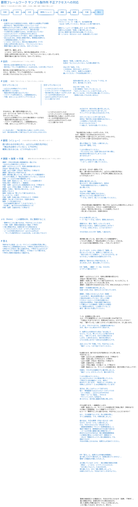

# 見本: 「会社が不正アクセスを受けた。何をどうすればいい？」

この文書は、`consult-on-board` スキルの相談の見本です。
相談者は社員 30 人ほどの部品加工の会社「サンプル製作所」で、総務と IT を兼ねる架空の担当者「佐野さん」です。Claude がその役を演じました。コンサルも Claude です。
会社も人も出来事も、すべて架空です。
相談は、被害への対応と再発の防止の話だけです。攻撃の手口には触れません。
相談者はまずチャットで話し、途中からホワイトボードへ移ります。
コンサルは要問フレームワーク（Issue-Driven）の 8 ステップで悩みを整理します。

- 往復: チャット 3 回、ボード 12 回（合計 15 回）
- 要問: 「調べ終わるのを待たずに、山口さんの取引先 20 社に『振込先は変わっていない』と今日中に確実に伝えるには、どうすればいいか？」
- 答え: 「9 時半までに転送・ルール・サインインの記録を写真に残し、10 時までに二段階認証を入れる。10 時半に社長の OK をもらい、12 時までに 20 社の一覧と文面を作る。17 時までに山口さんが前から知っている番号へ電話し、その後メールで確かめる。17 時半に警察の相談窓口へ電話する。」
- 最後のボード: [unauthorized-access-response-ja.excalidraw](unauthorized-access-response-ja.excalidraw)（Excalidraw で開けます）

## 1. チャット

**相談者**

> 相談させてください。会社が不正アクセスを受けたみたいで、何をどうすればいいか分からなくて困っています。
> 私は「サンプル製作所」という社員30人ほどの部品加工の会社で、総務とITを兼ねている佐野といいます（架空です）。
> 昨日、取引先から「振込先が変わったというメールが御社の営業の山口さんから来たけど本当？」と電話がありました。山口さんはそんなメールは送っていません。

**コンサル**

> 佐野さん、お話しくださってありがとうございます。まず落ち着いて、一緒に整理しましょう。
> 最初に、急ぎで確かめたいことが2つあります。
> - その取引先には「変更はない。振り込まないで」と、メール以外（電話など）でもう伝えましたか？
> - 山口さんのメールのパスワードは、もう変えましたか？
>
> そのうえで、いまの状況を少し聞かせてください。
> - 偽のメールは、山口さん本人のアドレスから出ていましたか？それとも似た別のアドレスでしたか？
> - 他の取引先にも、同じメールが届いていそうですか？
> - メールは何のサービスを使っていますか？（例：Microsoft 365、Google、プロバイダのメール）
>
> 分かる範囲で大丈夫です。

**相談者**

> ありがとうございます。答えます。
> - 電話をくれた取引先には、その場で「変更はないので振り込まないで」と電話で伝えました。まだ振り込んでいないそうです。
> - 山口さんのパスワードは、昨日の夕方に私が管理画面から変えました。ただ、それで十分なのかは分かりません。
> - 取引先の人が言うには、差出人は山口さん本人のアドレスだったそうです。似たアドレスかどうかは、私はまだメールそのものを見ていません。
> - 他の取引先に届いたかは、分かりません。山口さんは20社くらいとやり取りしています。
> - メールは Microsoft 365 です。社長の知り合いの業者さんが3年前に入れてくれて、管理者は私です。二段階認証は、正直、設定していません。

**コンサル**

> 取引先がまだ振り込んでいないのは、本当によかったです。すぐ電話で止めた佐野さんの判断のおかげです。
> 「パスワード変更で十分か」へのお答えです。それだけでは足りないことが多いです。Microsoft 365 の管理画面で、次をすぐ確かめてください。
> - 山口さんの「全セッションからサインアウト」を実行する（変更前のログインが残っていることがあるため）
> - 山口さんのメールに、身に覚えのない「転送」や「受信トレイのルール」がないか見る
> - サインインのログで、見覚えのない国や時間のログインがないか見る
> - 山口さんだけでも、二段階認証をすぐ入れる
>
> その先は、やることが多いので、順番をつけて整理しましょう。「要問フレームワーク」なら、背景から「いちばん答えるべき問い」を決めて、課題・対策・作業まで落とせます。今の佐野さんの「何をどうすればいいか」を一枚にできます。
> ホワイトボードで一緒に整理しますか？それともこのままチャットで進めますか？

**相談者**

> ありがとうございます。4つ、今日のうちにやってみます。転送の設定は、正直どこで見るのか分からないので、あとで教えてください。
> やることが多くて頭が追いつかないので、ホワイトボードで整理したいです。お願いします。

**コンサル**

> ホワイトボードを開きました。要問フレームワークの8つの段を描いて、佐野さんのお話を「背景」に書き写してあります（いま 1/8）。
> 足りない事実や違う所があれば、ボードに書いて Send を押してください。答えはボードに書きます。
> 転送の設定の見方は、整理の中で「作業」の段に入れて、あとでお伝えします。

## 2. ホワイトボード

相談者は黒い字で書き、Send を押します。コンサルは青い字で答え、左の欄（背景から答えまで）に要点をまとめます。
灰色の字は、書き方の例です。

### 2.1 背景

**コンサル（ボード）**

> こんにちは、Claude です。
> テキストツール（T）で書いて、右の紙飛行機（Send）を押してください。答えはここに青で書きます。
>
> 要問フレームワークで整理します（いま 1/8 背景）。
> 佐野さんのお話を「背景」に書き写しました。
> 足りない事実や違う所があれば書いてください。
> 例：いつから・何人のメールか・社長は知っているか

**相談者（ボード）**

> 佐野です。補足します。
> いつから：分かりません。取引先の電話は昨日（11/3）。
> 社長には昨日の夜に伝えました。「大ごとにしたくない」と言っています。
> 警察や誰かに届けるべきかも、分かっていません。

### 2.2 目的

**コンサル（ボード）**

> 補足を「背景」に書き写しました。
> 社長の「大ごとにしたくない」も大事な事実です。
>
> 次は 2/8「目的」です。
> この対応は、何のためにしますか？
> 「〜する」の形で、佐野さんの言葉で書いてください（下の灰色は例です）。

**相談者（ボード）**

> 取引先にお金の被害を出さないようにする。
> それと、取引先に「サンプル製作所のメールは大丈夫」と
> また信じてもらえるようにしたいです。

### 2.3 分析

**コンサル（ボード）**

> 目的を書き写しました。2つとも「〜する」の形で、筋が通っています。
>
> 次は 3/8「分析」です。
> いまの事実を「分かっていること」と「分かっていないこと」に分けてみましょう。
> 思いつくものを、それぞれの側に書いてください。
> （背景から拾ってもかまいません）

**相談者（ボード）**

> （分かっていないこと）
> ・いつから入られていたか
> ・どうやってパスワードが盗られたか
> ・他の取引先にも偽メールが行ったか
> ・メールの中身を読まれたか
> ・山口さん以外もやられているか
> ・どこに届けるべきか
>
> すみません、書く場所を間違えました。
> 上の・のリストは「分かっていないこと」です。
> 分かっていることは：
> ・山口さんの本物のアドレスから偽の請求メールが出た
> ・電話の取引先は振り込んでいない
> ・パスワードは昨日変えた。二段階認証はなし
> ・今朝、全セッションのサインアウトをした

**コンサル（ボード）**

> 大丈夫です、両方の列に書き写しました。
> （佐野さんのメモは下に並べました）
> サインアウトまで済んだのは大きいです。
>
> 分かっていないことが6つあります。
> 目的は「取引先にお金の被害を出さない」。
> この目的にいちばん効くのは、6つのうちどれですか？
> 1つ選んで、なぜかも書いてください。

**相談者（ボード）**

> 「他の取引先にも偽メールが行ったか」です。
> なぜ：電話をくれた所は止められたけど、
> 他の会社が黙って振り込んでしまうかもしれないから。
> でも、どうやって調べるのかは分かりません。

### 2.4 要問（イシュー）

**コンサル（ボード）**

> 選んだ理由ごと「分析」に書きました。
> 次は 4/8「要問」です。
>
> 1つだけ問わせてください。
> 「行ったかどうか」を調べ終わるまで待つ間に、
> 他の会社が振り込んでしまうことはありませんか？
>
> 佐野さんが本当に答えたい問いを、「〜か？」の形で1つ書いてください。

**相談者（ボード）**

> あります。それが一番怖いです。
> 問い：調べ終わるのを待たずに、山口さんの取引先20社に
> 「振込先は変わっていない」と今日中に確実に伝えるには、
> どうすればいいか？

### 2.5 課題

**コンサル（ボード）**

> 要問に書き写しました。
> 答えられて、答える価値があり、目的の「お金の被害を出さない」に直結する、良い問いです。
>
> 次は 5/8「課題」です。
> 今日中に20社へ確実に伝えるのに、越えないといけない壁は何ですか？
> 「〜する」の形で、思いつくだけ書いてください。

**相談者（ボード）**

> ・20社の担当者と電話番号を一覧にする（山口さんの頭の中にしかない）
> ・メールで伝えると、そのメール自体を疑われる
> ・社長に「取引先に知らせる」ことを納得してもらう
> ・何と言って伝えるか、文面を決める

**コンサル（ボード）**

> 4つとも書き写しました。
> 1・3・4は「〜する」の形で、要問に効きます。
>
> 課題2だけ、壁の「様子」になっています。
> 疑われないために、佐野さんは何をしますか？
> 「〜する」の形にすると、どうなりますか？
>
> それが決まったら 6/8「施策」へ進みます。

**相談者（ボード）**

> 請求書に載っている、前から知っている電話番号へ、
> こちらから電話して「振込先は変わっていない」と伝える。
> メールはその後の確認用にする。…で合っていますか？

### 2.6 施策

**コンサル（ボード）**

> 合っています。しかも一歩進んで「施策」の形になっていました。施策として書きました。
> 「前から知っている番号へ、こちらからかける」は、なりすましへの確かめ方の基本どおりです。
>
> 課題2は「疑われない手段で伝える」とまとめましたが、違えば直してください。
>
> 6/8「施策」：課題1・3・4は、それぞれどうやって越えますか？

**相談者（ボード）**

> 課題1：山口さんと二人で、名刺と請求書の控えから
> 　20社の一覧を紙で作る。午前中に。
> 課題3：社長には「黙っていて振り込まれたら、もっと大ごと」と
> 　話す。たぶん分かってくれると思います。
> 課題4：文面の作り方は分からないです。何を入れればいいですか？

**コンサル（ボード）**

> 課題1・3の施策を書き写しました。
> 社長への言い方は、目的とぴったり合っています。
>
> 課題4、文面に入れるとよいもの（候補）：
> 1 山口の名で、振込先変更の偽メールが出た
> 2 振込先は変わっていない（正しい口座）
> 3 そのメールのリンクや添付は開かない
> 4 振込先の変更は、今後も電話で確かめる
> 5 不審なメールの連絡先（佐野さんの電話）
> 6 ご迷惑のお詫びと、いま調べていること
>
> 要る・要らないを選んでください。

**相談者（ボード）**

> 1〜6、全部要ると思います。
> ただ、2で口座番号をメールにそのまま書くのは不安です。
> 「口座はこれまでどおりで、変更はありません」だけでいいですか？
> 6は、「調べている」と書くとかえって心配させないか、少し迷います。

**コンサル（ボード）**

> 2：はい、それで十分です。口座番号を書かない方が、偽メールと見分けやすく安全です。
>
> 6：佐野さんの目的の2つ目は「また信じてもらう」でした。
> 黙っていたことが後で分かるのと、「調べています。分かり次第お知らせします」と言われるのと、取引先の側ならどちらを信じますか？
> 決めるのは佐野さんです。
>
> 決まったら 7/8「作業」です。今日やることを、「誰が・いつ」つきで並べてみてください。

### 2.7 作業

**相談者（ボード）**

> 6は書きます。後で分かる方が信用をなくすと思います。
> 今日やること：
> ・佐野：山口さんの二段階認証を入れる（10時まで）
> ・佐野：社長に話してOKをもらう（10時半）
> ・山口＋佐野：20社の一覧を作る（12時まで）
> ・佐野：文面を作る（12時まで）
> ・山口：20社に電話、その後メール（17時まで）
> ・佐野：転送とルール、サインインの記録を見る（見方を教えてほしいです）

**コンサル（ボード）**

> 作業を、それぞれの施策の下に書き写しました。
> 「誰が・いつ」がそろっていて、動ける形です。
>
> 1つだけ問わせてください。
> もし山口さんのメールに転送が残っていたら、17時までに送る確認メールも、相手に読まれてしまいます。
> 「転送とルールを見る」は何時にしますか？（いまは時間が空いています）
>
> 見方は、詳しくはチャットで送ります。
> 短く：管理画面で山口さんのメールボックスの「メール転送」、山口さんのOutlookの「設定 → ルール / 転送」、Entra の「サインインログ」を見ます。
> 見つけたら、消す前に画面を写真に残します。

**相談者（ボード）**

> それは困ります。一番最初にします。
> ・佐野：転送とルール、サインインの記録を見て写真に残す（9時半まで）
> その後に二段階認証、という順番でいいですか？
> もう一つ：警察やどこかに届けるのは、今日やることに入りますか？

**コンサル（ボード）**

> はい、その順番でよいです。先に証拠を残し、すぐ二段階認証、です。作業を直しました。
>
> 届け出は、今日の要問（20社へ伝える）の外なので、左下の「メモ」に置きました。
> ただ、今日できる小さな一歩はあります：
> ・都道府県警察の「サイバー犯罪相談窓口」に電話で相談する（被害届を出すかは後で決める）
> ・メールの中身に顧客の個人情報があって読まれたおそれがあれば、個人情報保護委員会への報告が要ることがあります（期限あり）
> ・IPA の「情報セキュリティ安心相談窓口」でも相談できます
>
> 今日の作業に入れるかは、佐野さんが決めてください。

**相談者（ボード）**

> 警察の相談窓口への電話だけ、今日の夕方に入れます（佐野、17時半）。
> 個人情報の件は、記録を見てから明日決めます。
> 頂いた要問と作業の並びで、やることが見えました。
> これで動いてみます。ありがとう、終わり。

### 2.8 答え

**コンサル（ボード）**

> 8/8「答え」に、佐野さんの作業を時間順に並べ直しただけで書きました（言葉は変えていません）。
> 警察への電話も作業に入れました。
>
> まだ開いている点（メモ）：個人情報の報告の判断（明日）、いつから・どうやって入られたか、「また信じてもらう」ための次の手。
> 落ち着いたら、また一緒に整理しましょう。
> お疲れさまでした。今日はうまくいきますように。

## 3. チャット（おわりのあと）

ボードで約束した「転送の見方」を、コンサルはチャットで送りました。

**コンサル**

> 転送・ルール・サインインの記録の見方です（Microsoft 365、画面の名前は版で少し変わります）。
> 1. 転送（管理者として）：Microsoft 365 管理センター →「ユーザー」→「アクティブなユーザー」→ 山口さん →「メール」タブ →「メール転送」。見覚えのない宛先が入っていないか。Exchange 管理センターの「メールボックス」→ 山口さん →「メールフローの設定」でも見られます。
> 2. 受信トレイのルール（山口さんのOutlook on the web で）：右上の歯車「設定」→「メール」→「ルール」。「特定の言葉のメールを削除・移動」「外へ転送」など、本人が作っていないルールがないか。同じ画面の「転送」も見ます。
> 3. サインインの記録：Microsoft Entra 管理センター →「ユーザー」→ 山口さん →「サインインログ」。見覚えのない国・時間・端末がないか。保存期間が短い（無料の範囲では7日ほど）ので、今日のうちに画面を残してください。
> 4. 見つけたら：消す前に画面の写真（日時が分かる形）を残し、それから消す。届け出や業者さんに見せる証拠になります。
>
> 分からない所は、業者さんにも一緒に見てもらうと安心です。

## 4. 相談者の感想

- 分かりやすかった所: コンサルは毎回、問いを 1 つだけ出し、「〜する」「〜か？」と書く形も示した。相談者の言葉を書き写してから次へ進むので、整理が進んでいると実感できた。「転送が残っていたら確認メールも読まれる」と問い返され、相談者は証拠を写真に残す作業を一番前へ動かした。
- 困った所: 届け出先（警察・IPA・個人情報保護委員会）の話は終盤に出てきた。慌てている側としては、もう少し早く知りたかった。
- ボードの使いにくさ: Claude が書くと画面の位置が動き、自分の書き込みが見えなくなった。左のプロパティパネルが書く場所を覆った。テキストツールで既存の文字の近くをクリックすると、その文字の編集になり、一度「分かっていること」を上書きしてしまった（コンサルが両方の列に書き直した）。
